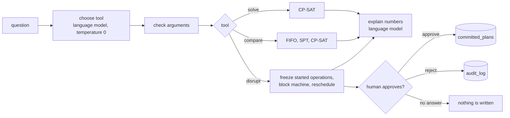
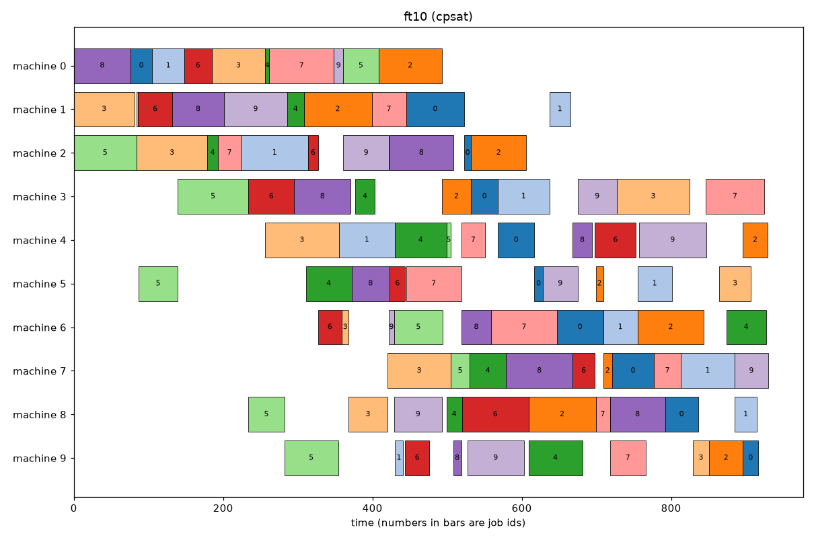
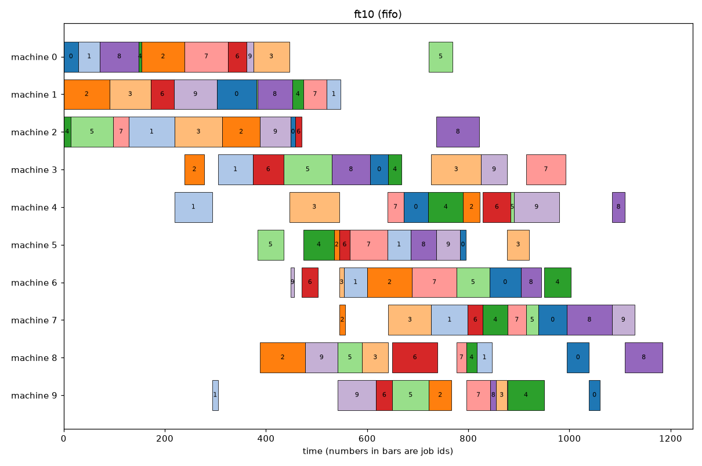
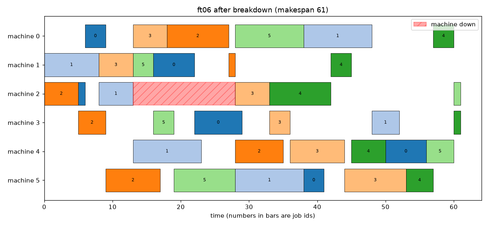

# scheduling-copilot

Ask what-if questions about a job-shop schedule and get answers from a real solver.

The solver is OR-Tools CP-SAT. The language model never builds or edits a schedule. It only
chooses one of three tools (`solve`, `disrupt`, `compare`) and explains the numbers the tool
returns. A new plan after a machine breakdown is only saved after a human approves it.

Data: public OR-Library job-shop instances (ft06, ft10, ft20, la01 to la10) with proven optimal
makespans. Output: a Swagger page and Gantt charts as PNG. There is no web UI.

## How it works



| Folder | Purpose |
| --- | --- |
| `scheduler/` | Pure Python: instance loader, CP-SAT model, FIFO and SPT rules, disruption logic, schedule validator, Gantt chart. No language model in here. |
| `agent/` | Model interface (Groq, Ollama fallback, temperature 0), the three tools with argument checks, the LangGraph graph with the approval interrupt, the Postgres store. |
| `api/` | FastAPI endpoints. |
| `evals/` | 30 questions, ground truth from the solver, a runner, a regex baseline and the results table. |
| `data/` | The OR-Library file, best-known values, source and licence note. |
| `docs/learn/` | Plain-language notes: concepts, walkthroughs, 10 interview questions, glossary. |

## Run it

You need Docker Desktop. For the tests you also need Python 3.11.

```bash
cp .env.example .env            # change the database password

docker compose up -d --build    # Postgres and the API
```

Open http://localhost:8000/docs for the Swagger page.

**Direct tools** (no model needed, nothing is saved): `POST /solve`, `POST /disrupt`, `POST /compare`,
`GET /instances/{name}/gantt.png?method=cpsat|fifo|spt`.

**The copilot** (needs a model, see below):

```bash
# 1. Ask. If the answer is a new plan, the status is "awaiting_approval" and nothing is saved yet.
curl -X POST localhost:8000/ask -H "Content-Type: application/json" \
  -d '{"question": "Machine 2 breaks down at time 10 for 15 time units on ft06. What happens?"}'

# 2. Look at the proposed plan.
#    http://localhost:8000/proposals/<thread_id>/gantt.png

# 3. A person decides. Only "approve" writes the plan (and logs who approved it).
curl -X POST localhost:8000/approvals/<thread_id> -H "Content-Type: application/json" \
  -d '{"decision": "approve", "reviewer": "your name"}'

# 4. See the saved plans and the audit trail.
curl localhost:8000/plans
curl localhost:8000/audit
```

### Which model answers /ask?

- **Groq** (default): put a free key in `GROQ_API_KEY` in `.env`. The default model is
  `openai/gpt-oss-20b`, which supports tool use. Check the Groq console for current model names and
  your rate limits, and change `GROQ_MODEL` if needed.
- **Ollama** (fallback): set `OLLAMA_URL`, for example `http://host.docker.internal:11434`, with a
  model that supports tool calling. It is used when Groq fails.
- **Demo mode without any model**: set `LLM_BACKEND=regex`. A rule-based parser then understands
  simple, regular questions. It is the baseline of the evaluation, not an intelligent model.

The tests never call a real model. They use a scripted fake, so no key is needed.

## Results

### Reaching the known optimum

Every instance was solved to proven optimality and matches the published value, including
ft06 = 55 and ft10 = 930 (ft10 in about 10 seconds). Full table and sources: [data/README.md](data/README.md).

### Why use a solver: dispatch rules versus CP-SAT

Measured with `POST /compare`:

| Instance | Best known | FIFO | SPT | CP-SAT |
| --- | --- | --- | --- | --- |
| ft06 | 55 | 65 (+18.2%) | 94 (+70.9%) | 55 (0%) |
| la01 | 666 | 772 (+15.9%) | 1185 (+77.9%) | 666 (0%) |
| ft10 | 930 | 1184 (+27.3%) | 1429 (+53.7%) | 930 (0%) |




### What a breakdown does

`ft06`, machine 2 breaks down at time 10 for 15 units. A frozen operation was still running on that
machine until time 13, so the real breakdown window is 13 to 28. The makespan goes from 55 to 61, 8
operations stay frozen and 16 move.



### Evaluation of question answering

30 questions in four groups: solve (8), compare (8), disrupt (9), unclear or incomplete (5). The answer
key is computed by calling the solver directly. Details and failures: [evals/results.md](evals/results.md).

| System | Tool correct | Arguments correct | Numbers faithful | All three |
| --- | --- | --- | --- | --- |
| Regex baseline | 77% (23/30) | 77% (23/30) | 100% (30/30) | 77% (23/30) |
| Language model (Groq) | not run yet | not run yet | not run yet | not run yet |

The language model column is empty because it needs your own Groq key. After adding it, run
`python -m evals.run --system both --write` and the table is filled in, with the questions it fails.

About the baseline: my first question set was too tidy and the regex parser scored 30 out of 30, which
means the test could not tell systems apart. I rewrote eight questions into more natural phrasing
(spelled-out numbers, unusual order, a double breakdown) and left the baseline untouched.

### Tests

```bash
python -m venv .venv
.venv/Scripts/pip install -r requirements-dev.txt     # Linux/macOS: .venv/bin/pip
docker compose up -d postgres
.venv/Scripts/python -m pytest
```

90 tests. They create their own database (`sched_test`). They include: frozen operations unchanged,
valid plans, no approval means no write, reject means no write, a paused proposal survives an API
restart, answer numbers equal tool output, and an invented number is caught. As a check on the tests
themselves, I broke the approval rule and the freeze rule on purpose and the tests failed.

## Design choices

- **The model never touches a schedule.** It picks a tool and explains numbers. Arguments from the model
  are validated and unknown fields are dropped. The solver result is validated again.
- **One graph, one purpose.** LangGraph is used only for the approval pause. The state is stored in Postgres,
  so a proposal can wait and survive a restart.
- **Direct endpoints cannot save.** The only code that writes a plan is the last step of the approval flow.
- **Disruption rule.** Operations that started before the breakdown keep their start time. If one is still
  running on the broken machine, it finishes first and the breakdown starts after it.

## Limits

- Times have no unit in the benchmark data, so durations like "2 hours" cannot be converted. The copilot
  should ask for times in the instance's own units. This is one of the evaluation questions.
- Machines are numbered from 0, as in the data.
- The solver is given a time limit (20 seconds). The 13 instances here finish well inside it. Large instances would
  return a good plan with a gap, not a proven optimum.
- A rescheduled plan minimises the makespan only. It does not try to minimise how many operations move.
- The base plan before a breakdown comes from a single-worker solve (or the last committed plan). Its
  schedule is deterministic for small instances; for ft10 it depends on the time limit.
- There is no authentication on the API. Do not expose it to the internet.

## Data source and licence

Instances: OR-Library (J E Beasley), file `jobshop1.txt`, MIT licence. Best-known values: JSPLIB, re-checked with
CP-SAT. Full sources and citation: [data/README.md](data/README.md).

Code: MIT, see `LICENSE`.
