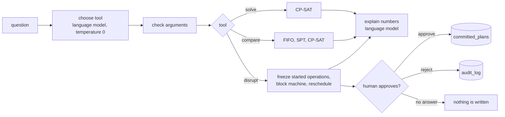

# scheduling-copilot

Ask what-if questions about a job-shop schedule and get answers from a real solver.

The solver is OR-Tools CP-SAT. The language model never builds or edits a schedule. It only
chooses one of three tools (`solve`, `disrupt`, `compare`) and explains the numbers the tool
returns. A new plan after a machine breakdown is only saved after a human approves it.

Data: public OR-Library job-shop instances (ft06, ft10, ft20, la01 to la10) with proven optimal
makespans. Output: a Swagger page and Gantt charts as PNG. There is no web UI.

## How it works



| Folder | Purpose |
| --- | --- |
| `scheduler/` | Pure Python: instance loader, CP-SAT model, FIFO and SPT rules, disruption logic, schedule validator, Gantt chart. No language model in here. |
| `agent/` | Model interface (Groq, Ollama fallback, temperature 0), the three tools with argument checks, the LangGraph graph with the approval interrupt, the Postgres store. |
| `api/` | FastAPI endpoints. |
| `evals/` | 30 questions, ground truth from the solver, a runner, a regex baseline and the results table. |
| `data/` | The OR-Library file, best-known values, source and licence note. |
| `docs/learn/` | Plain-language notes: concepts, walkthroughs, 10 interview questions, glossary. |

## Run it

You need Docker Desktop. For the tests you also need Python 3.11.

```bash
cp .env.example .env            # change the database password

docker compose up -d --build    # Postgres and the API
```

Open http://localhost:8000/docs for the Swagger page.

**Direct tools** (no model needed, nothing is saved): `POST /solve`, `POST /disrupt`, `POST /compare`,
`GET /instances/{name}/gantt.png?method=cpsat|fifo|spt`.

**The copilot** (needs a model, see below):

```bash
# 1. Ask. If the answer is a new plan, the status is "awaiting_approval" and nothing is saved yet.
curl -X POST localhost:8000/ask -H "Content-Type: application/json" \
  -d '{"question": "Machine 2 breaks down at time 10 for 15 time units on ft06. What happens?"}'

# 2. Look at the proposed plan.
#    http://localhost:8000/proposals/<thread_id>/gantt.png

# 3. A person decides. Only "approve" writes the plan. The audit log keeps the reviewer name sent
#    with the request (not authenticated).
curl -X POST localhost:8000/approvals/<thread_id> -H "Content-Type: application/json" \
  -d '{"decision": "approve", "reviewer": "your name"}'

# 4. See the saved plans and the audit trail.
curl localhost:8000/plans
curl localhost:8000/audit
```

### Which model answers /ask?

- **Groq** (default): put a free key in `GROQ_API_KEY` in `.env`. The default model is
  `openai/gpt-oss-20b`, which supports tool use. Check the Groq console for current model names and
  your rate limits, and change `GROQ_MODEL` if needed.
- **Ollama** (fallback): set `OLLAMA_URL`, for example `http://host.docker.internal:11434`, with a
  model that supports tool calling. It is used when Groq fails.
- **Demo mode without any model**: set `LLM_BACKEND=regex`. A rule-based parser then understands
  simple, regular questions. It is the baseline of the evaluation, not an intelligent model.

The tests never call a real model. They use a scripted fake, so no key is needed.

## Results

### Reaching the known optimum

Every instance was solved to proven optimality and matches the published value, including
ft06 = 55 and ft10 = 930 (ft10 in about 10 seconds). Full table and sources: [data/README.md](data/README.md).

### Why use a solver: dispatch rules versus CP-SAT

Measured with `POST /compare`:

| Instance | Best known | FIFO | SPT | CP-SAT |
| --- | --- | --- | --- | --- |
| ft06 | 55 | 65 (+18.2%) | 94 (+70.9%) | 55 (0%) |
| la01 | 666 | 772 (+15.9%) | 1185 (+77.9%) | 666 (0%) |
| ft10 | 930 | 1184 (+27.3%) | 1429 (+53.7%) | 930 (0%) |


### What a breakdown does

`ft06`, machine 2 breaks down at time 10 for 15 units. A frozen operation was still running on that
machine until time 13, so the real breakdown window is 13 to 28. The makespan goes from 55 to 61, 8
operations stay frozen and 16 move. The other 12 of the 36 operations were not frozen but kept their
start time.

An approved breakdown stays in force. Each committed plan stores all breakdown windows that apply to it
(the column `disruptions` in `committed_plans`: the windows of the previous plan plus the new one). A
later disruption on the same instance starts from the latest committed plan and cannot place work on
a machine during an earlier outage. For example, after the ft06 breakdown above, a second breakdown of
machine 3 at time 5 for 10 units gives a plan where machine 2 stays idle from 13 to 28. Without the stored
window, that plan used machine 2 during the earlier outage with 2 operations.


### Evaluation of question answering

30 questions in four groups: solve (8), compare (8), disrupt (9), unclear or incomplete (5). The 30 questions
were written by Claude Code. The answer key is computed by calling the solver directly, never by a language
model. Model: Groq `openai/gpt-oss-20b` with temperature 0. Details and failures: [evals/results.md](evals/results.md).
The raw data of each run is in [evals/runs/](evals/runs/).

| System | Tool correct | Arguments correct | Numbers faithful | All three |
| --- | --- | --- | --- | --- |
| Regex baseline | 77% (23/30) | 77% (23/30) | 100% (30/30) | 77% (23/30) |
| Language model (Groq) | 93% (28/30) | 93% (28/30) | 100% (30/30) | 93% (28/30) |

By group (questions passed):

| Group | Regex baseline | Language model |
| --- | --- | --- |
| solve | 5/8 | 8/8 |
| compare | 7/8 | 8/8 |
| disrupt | 7/9 | 9/9 |
| unclear or incomplete | 4/5 | 3/5 |

I ran the evaluation three times on 24 Oct 2026 (UTC) with the model `openai/gpt-oss-20b` at temperature 0:

| Run | Regex baseline | Language model |
| --- | --- | --- |
| 1 | 23/30 | 28/30 |
| 2 | 23/30 | 28/30 |
| 3 | 23/30 | 28/30 |

The three runs gave the same score and the same tool and arguments for every question. Average time per question
was between 3.8 and 5.2 seconds per run, most of it the solver. In every case where the tool and arguments were
right (25 questions per run, 75 in total), the tool output was identical to a direct call of the solver.

n = 30 is small. Two-sided Fisher exact tests (computed with `math.comb`) for the language model against the baseline:
overall 28/30 against 23/30 gives p = 0.1455, so that difference could be chance. On the 25 answerable questions only,
25/25 against 19/25 gives p = 0.0223. That is below 0.05, but 25 questions are a small sample and the questions are
not independent of each other, so I treat it as a hint and not as proof.

**Where the language model is better.** It passes all 25 answerable questions. The baseline fails
six of them, for example on "machine four" (spelled-out number), "ft 20" (a space in the name),
"first-in-first-out" instead of "FIFO", and "we lose machine 3".

**Where the language model fails.** Both failures are in the unclear group, where the correct reaction is to ask:

- "Machine 2 breaks down on ft06 at time 10 for **2 hours**." The model silently used 2 as the duration.
  The instance has no hours, so the right answer was to ask. The regex baseline asks here, because it has an
  explicit rule for time words.
- "Machine 2 is down at time 10 **and again at time 40** for 5 units." The model only passed the first
  breakdown to the tool, but its answer text talks about both. The numbers were faithful, so the faithfulness
  check did not catch it. It is a limit of what that check can see.

Two questions ("between time 50 and time 90", "from 400 to 500") needed the model to subtract to get a duration.
It did that correctly, but this is arithmetic done by the model. A safer tool would take a start and an end
time instead of a duration.

Numbers are faithful for the baseline by construction, because its answer is a template.

About the baseline: my first question set was too tidy and the regex parser scored 30 out of 30, which
means the test could not tell systems apart. I rewrote eight questions into more natural phrasing
(spelled-out numbers, unusual order, a double breakdown) and left the baseline untouched.

### Tests

```bash
python -m venv .venv
.venv/Scripts/pip install -r requirements-dev.txt     # Linux/macOS: .venv/bin/pip
docker compose up -d postgres
.venv/Scripts/python -m pytest
```

117 tests. They create their own database (`sched_test`). They include: frozen operations unchanged,
valid plans, an earlier breakdown stays in force, no approval means no write, reject means no write, a paused proposal survives an API
restart, answer numbers equal tool output, and an invented number is caught. As a check on the tests
themselves, I broke the approval rule and the freeze rule on purpose and the tests failed.

## Design choices

- **The model never touches a schedule.** It picks a tool and explains numbers. Arguments from the model
  are validated and unknown fields are dropped. The solver result is validated again.
- **One graph, one purpose.** LangGraph is used only for the approval pause. The state is stored in Postgres,
  so a proposal can wait and survive a restart.
- **Direct endpoints cannot save.** The only code that writes a plan is the last step of the approval flow.
- **Disruption rule.** Operations that started before the breakdown keep their start time. If one is still
  running on the broken machine, it finishes first and the breakdown starts after it.

## Determinism

The base plan and every disruption use one worker and a fixed seed, so the same question gives the same
plan. `solve` and `compare` use several workers, so the schedule can differ between runs, while the optimal
makespan does not. The evaluation is built so that this does not matter: the model sees and the checks
compare the numbers of the tool output (makespan, gap, status, counts), not the list of operations.

`evals/checks.py` compares two things. First, every number in the model's answer must also appear in the tool
output or in the question, rounded to the number of decimals the answer shows (so "18%" matches 18.18, "19"
does not); instance names such as ft06 are ignored. It does not check whether a sentence is true or
complete. Second, the tool arguments must equal the expected ones exactly, whole numbers compared as whole
numbers, and extra or missing keys count as wrong. The separate check "tool output equals a direct solver
call" is in `evals/run.py`: it compares the tool output with a direct call of the solver, ignoring the
timing fields.

## Limits

- Times have no unit in the benchmark data, so durations like "2 hours" cannot be converted. The copilot
  should ask for times in the instance's own units. This is one of the evaluation questions.
- Machines are numbered from 0, as in the data.
- The solver is given a time limit (20 seconds). The 13 instances here finish well inside it. Large instances would
  return a good plan with a gap, not a proven optimum.
- A rescheduled plan minimises the makespan only. It does not try to minimise how many operations move.
- The base plan before a breakdown comes from a single-worker solve (or the last committed plan). The
  reschedule also uses one worker and a fixed seed, so the same question always gives the same plan. Several
  different schedules can share the best makespan, and the solver does not try to keep the number of moved
  operations small.
- Plans committed before the `disruptions` column existed have no stored windows, so a later breakdown only
  knows the windows of plans saved after the change. An existing database gets the column when you run
  `db/init.sql` once more:
  `docker compose exec -T postgres sh -c 'psql -U "$POSTGRES_USER" -d "$POSTGRES_DB"' < db/init.sql`.
- Two proposals made from the same base plan can both be approved. The second one ignores the first.
- There is no authentication on the API. The reviewer name is whatever the request says. Do not expose it
  to the internet.

## Data source and licence

Instances: OR-Library (J E Beasley), file `jobshop1.txt`, MIT licence. Best-known values: JSPLIB, re-checked with
CP-SAT. Full sources and citation: [data/README.md](data/README.md).

Code: MIT, see `LICENSE`.
